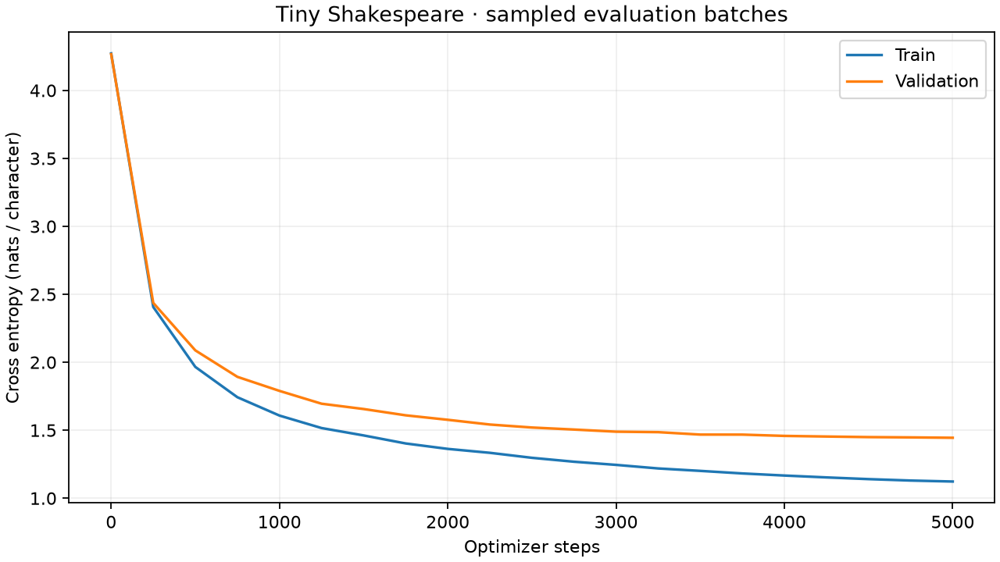

# gpt-from-scratch · minigpt

A small, readable GPT-style decoder trained from scratch in PyTorch, with manual
causal attention, reproducible experiments, and real Tiny Shakespeare results.

[](https://github.com/Jakob067/minigpt/actions/workflows/ci.yml)
[](LICENSE)

**Local checks pass. GitHub Actions has not run yet: nothing has been pushed.**
The repository remote was already configured as `Jakob067/minigpt`; the badge
will reflect that repository after you publish it.

## Quick start

From the repository root, with Python 3.11+ and internet access for installation
and the first dataset download:

```sh
make install
make test
make train-tiny
```

The Makefile prefers `python3.11` when installed. Override with
`make install PYTHON=/path/to/python3.11` if needed. Recorded dependencies are
pinned in `requirements.lock`; install a compatible Python version for those
wheels. CUDA users can preinstall the appropriate PyTorch wheel. The Python
project requires neither Rust nor Node.

```sh
make lint
make generate
.venv/bin/minigpt-generate --checkpoint models/tiny.pt --prompt 'ROMEO:'
```

### Desktop GUI

Run `make gui` from the repository root after `make install`. The GUI uses
Tkinter, which needs to be available in your Python installation. It opens with
the bundled Tiny checkpoint selected. Enter a prompt, adjust the sampling
settings, and click **Generate**. Use the checkpoint picker to switch to an
existing training run or open another trusted local `.pt` file.

The included Tiny checkpoint is a small smoke-run model, not the Small model
behind the samples below. Existing run directories are protected from accidental
replacement. To rerun, use a new output directory:

```sh
.venv/bin/minigpt-train --config configs/tiny.yaml --out-dir runs/tiny-repeat
```

## Architecture

```text
UTF-8 text -> sorted character vocabulary -> token IDs (B,T)
  -> token embedding + learned position embedding -> dropout
  -> repeat L times:
       x += causal self-attention(LayerNorm(x))
       x += GELU MLP(LayerNorm(x))
  -> final LayerNorm -> tied output head -> logits (B,T,V)
```

Q/K/V projection, scaled dot products, causal masking, softmax and head merging
are explicit. Pre-LayerNorm residual blocks, 4x GELU MLPs, GPT-2-style
initialization, dropout, optional biases/positions, and tied embeddings are all
implemented with PyTorch primitives. An optional SDPA fast path has output and
gradient parity tests. There is no pretrained model or library Transformer.
Device detection prefers CUDA, then MPS, then CPU.

Tiny: 2 layers, 4 heads, width 64, context 64, **108,352 parameters**.
Small: 6 layers, 6 heads, width 384, context 256, dropout 0.2,
**10,770,816 parameters** with the 65-character vocabulary.
The exact formula and tensor shapes are explained in [docs/DESIGN.md](docs/DESIGN.md)
and verified by a parameter-count test.

## Results from completed runs

The same contiguous 90/10 split is used throughout. Full evaluation scores all
111,539 validation targets exactly once, resetting context at each input block
and weighting the final short block by its number of targets. The bigram counts
are fitted only on training pairs. The vocabulary inventory uses the complete
corpus, matching the character-level nanoGPT preparation convention.

| Model | Validation loss (nats) | Perplexity | Bits/char |
|---|---:|---:|---:|
| Uniform | 4.1744 | 65.0000 | 6.0224 |
| Count bigram (add-one smoothing) | 2.4819 | 11.9638 | 3.5806 |
| Tiny · 200 steps | 2.4451 | 11.5313 | 3.5275 |
| Small · 5,000 steps | 1.4531 | 4.2763 | 2.0964 |

Sources: [Small metrics](reports/metrics.json), [Tiny metrics](reports/tiny_metrics.json),
[training CSV](reports/small_train.csv), and [full training metadata](reports/small_train.json).
Uniform loss is `ln(65)`; perplexity is `exp(loss)` and bits/char is `loss/ln(2)`.



The curve uses fixed sampled evaluation batches, so its final validation value
(1.4446) differs slightly from the full-split result
(1.4531). The best checkpoint was step 5,000.
The train/validation gap is substantial: this small corpus permits overfitting.

## Unedited generated samples

Small checkpoint, CPU inference, seed 1337, 160 new characters each. No
cherry-picking or editing; the full eight outputs and settings are in
[reports/samples.md](reports/samples.md) and [samples.json](reports/samples.json).

Temperature 0.5, prompt `ROMEO:`:

```text
ROMEO:
The matter dead and the lineaments of him.

POLIXENES:
I have seen to hear thee, my lord,
I would not yield the season and do the great morning soul:
The nobili
```

Temperature 1.2, same prompt and seed:

```text
ROMEO:
Canst thou denia? To laze undeed a jealous gentleman bitter, with
this base, seeing to flatterpose, coyful. The soldier feasts, of
the news, I am power to paint
```

The model picks up speaker labels and local language patterns, but sentences can
be incoherent and invented words become common at higher temperature. The full
sample file also contains temperatures 0.8, additional prompts, top-k=20 and
nucleus sampling with top-p=0.9. Generate your own:

```sh
.venv/bin/minigpt-generate --checkpoint runs/small/best.pt --prompt 'JULIET:' --temperature 0.8 --top-p 0.9 --seed 1337
```

## Ablations

One architecture factor changes at a time. Every unique variant gets **1,048,576
training tokens**, seeds **1337 and 2024**, batch size **16**, and the same peak/min
LR, weight decay, dropout, optimizer and normalized LR schedule. Warmup is 5% of
steps and evaluation occurs four times after initialization. The last checkpoint
is scored on the full split. Values are arithmetic mean ± sample standard
deviation (`ddof=1`), including transforming each seed's loss before averaging
perplexities. Six unique variants / twelve runs share the common baseline
across groups. These shorter runs are distinct from the 5,000-step main run.

| Factor | Value | Loss (nats) | Perplexity | Bits/char |
|---|---|---:|---:|---:|
| n_layer | 2 | 2.4362 ± 0.0009 | 11.4297 ± 0.0103 | 3.5147 ± 0.0013 |
| n_layer | 4 | 2.4259 ± 0.0052 | 11.3125 ± 0.0592 | 3.4998 ± 0.0075 |
| n_layer | 6 | 2.4276 ± 0.0004 | 11.3317 ± 0.0044 | 3.5023 ± 0.0006 |
| block_size | 64 | 1.9358 ± 0.0088 | 6.9299 ± 0.0608 | 2.7928 ± 0.0127 |
| block_size | 128 | 2.0891 ± 0.0049 | 8.0773 ± 0.0394 | 3.0139 ± 0.0070 |
| block_size | 256 | 2.4276 ± 0.0004 | 11.3317 ± 0.0044 | 3.5023 ± 0.0006 |
| positional_embeddings | on | 2.4276 ± 0.0004 | 11.3317 ± 0.0044 | 3.5023 ± 0.0006 |
| positional_embeddings | off | 2.4358 ± 0.0025 | 11.4249 ± 0.0289 | 3.5141 ± 0.0036 |


Four layers marginally outperform six in this short budget, but two seeds do
not justify a ranking claim. Learned positions help a little; removing them
does not remove all order information because causal masking still distinguishes
prefixes. The strongest apparent result is the shorter context. **This does not
show that shorter contexts are intrinsically better:** at fixed sequence batch
size, context 64 receives 1,024 updates, context 128 gets 512, and context 256 only
256. The LR schedule is normalized over tokens, but the effective tokens per
update and evaluation contexts differ. A follow-up would control tokens per
update and train longer with more seeds. No such follow-up results are claimed.

[CSV](reports/ablations.csv), [all per-seed runs/configs/histories](reports/ablations.json),
[grid settings](configs/ablation.yaml).

## Reproduce the experiments

Hardware: **Apple M5 Pro, 24 GiB**, macOS 26.7.2, Python 3.11.18,
PyTorch 2.15.0, FP32/MPS, four CPU threads. Evaluation and recorded generation
were repeated on CPU. CUDA BF16 is optional and explicitly checked for support;
MPS and CPU use FP32. No `torch.compile` is used.

| Config | Batch | Context | Measured tokens/s | ms/update |
|---|---:|---:|---:|---:|
| tiny | 32 | 64 | 695,425 | 2.94 |
| small | 16 | 256 | 46,799 | 87.52 |

Warmup: five updates; timed: twenty updates, synchronized around measurement.
The main run took **487.35 s (8.12 min)** of logged monotonic
training time. The complete ablation grid took **285.54 s (4.76 min)**.
These measurements exclude cold initialization; OS sleep and wall-clock changes
can produce larger timestamp gaps. See [benchmark details](reports/bench.md).

Exact commands, run from this directory in a fresh checkout:

```sh
make install
make lint
make test
.venv/bin/python -m minigpt.benchmark
.venv/bin/minigpt-train --config configs/tiny.yaml
.venv/bin/minigpt-train --config configs/small.yaml
.venv/bin/minigpt-eval --checkpoint runs/small/best.pt
.venv/bin/minigpt-ablate --config configs/ablation.yaml
.venv/bin/python -m minigpt.report --device cpu
```

The throughput benchmark was originally run before choosing the final main-run
budget; its embedded config records 1,000 steps. The final main run used the
unchanged architecture and batch size with 5,000 steps and 100 warmup steps.
Every JSON report embeds the actual config and source commit rather than
assuming current defaults. The original main-training commit was
`58afd6dbeaa107fbd09112b473808fe57e506d46`. Use the recorded source commits and locked
dependencies when investigating exact reproduction; results are not guaranteed
bitwise identical across devices or software versions.

Dataset: [tiny Shakespeare from char-rnn](https://github.com/karpathy/char-rnn/tree/master/data/tinyshakespeare),
UTF-8, SHA-256 `86c4e6aa9db7c042ec79f339dcb96d42b0075e16b8fc2e86bf0ca57e2dc565ed`.
Downloads are checksum-verified and kept outside Git. RNG seeds cover Python,
NumPy, PyTorch, accelerator, and the batch sampler. Resume captures all relevant
states. To exercise interruption while preserving the original LR horizon:

```sh
.venv/bin/minigpt-train --config configs/small.yaml --stop-after 2500
.venv/bin/minigpt-train --config configs/small.yaml --resume runs/small/last.pt
```

Use this example in a fresh run directory. Resuming preserves max_iters, LR
schedule, optimizer, RNG and best checkpoint. `--reuse-completed` allows the
grid to reuse completed runs whose config and dataset match. Checkpoints use
PyTorch pickle for full RNG restoration and are intended for trusted local files.

The small checkpoint is approximately 43 MB for FP32 weights alone and is not
committed; full optimizer checkpoints remain in ignored `runs/`. Reproduce it
with the recorded command. The completed Tiny checkpoint and its fingerprint
are included as [models/tiny.pt](models/tiny.pt) and [models/tiny.json](models/tiny.json).

## Tests and project map

CPU tests cover causality, variable output shapes/context rejection, single-batch
overfitting, tokenizer round trips, fixed-seed generation, top-k=1/greedy parity,
nucleus filtering, parameter counts, weight tying, checkpoint logits, exact
interrupted/resumed CPU training with dropout, resuming into a new directory,
manual/SDPA output and gradient parity, full-validation token weighting, dataset
checksum failures, and ablation budgets/aggregation. Tests use synthetic text and
need no network or dataset download. The GitHub job uses Python 3.11 and CPU.

- `src/minigpt/`: configuration, data, model, optimizer/training, inference and experiments.
- `configs/`: Tiny, Small and the equal-token ablation grid.
- `tests/`: fast CPU regression tests.
- `reports/`: completed metrics, loss curves, samples, benchmark and ablations.
- `docs/DESIGN.md`: tensor shapes, exact parameter formula, reproducibility boundaries.
- `docs/LEARNING.md`: German milestone explanations and interview questions with answers.

## What I learned

Causality and shape tests make attention's indexing assumptions explicit.
A single-batch overfit test checks whether the whole optimization path can learn,
while baselines keep validation improvements in context. Exact resume requires
more than model weights. Finally, an equal-token budget can still conceal
important experimental differences such as optimizer update count; reporting
those differences matters more than choosing an attractive table winner.

## Limitations and optional work

Character-level modeling, one tiny dataset, no instruction following, a small
seed count, and limited context constrain what these results mean. There is no
held-out test split; validation is used for checkpoint selection. Long ablations
and conclusions about broad language ability are outside the evidence here.
Generation currently recomputes the full cropped context, without a KV cache.

The Python project is complete at v0.1.0. KV cache, binary export/golden vectors,
Rust inference, WASM/browser UI and BPE remain separately approved stretch goals.
No Rust or TypeScript implementation has been introduced, so there is no claimed
cross-language parity, export test, or Rust benchmark.

## References and license

- [Vaswani et al., Attention Is All You Need](https://arxiv.org/abs/1706.03762).
- [Andrej Karpathy, nanoGPT](https://github.com/karpathy/nanoGPT).
- [Andrej Karpathy, Let's build GPT](https://www.youtube.com/watch?v=kCc8FmEb1nY).

Code and included Tiny weights: [MIT](LICENSE). The downloaded Shakespeare
corpus is attributed above and is not redistributed in Git.
